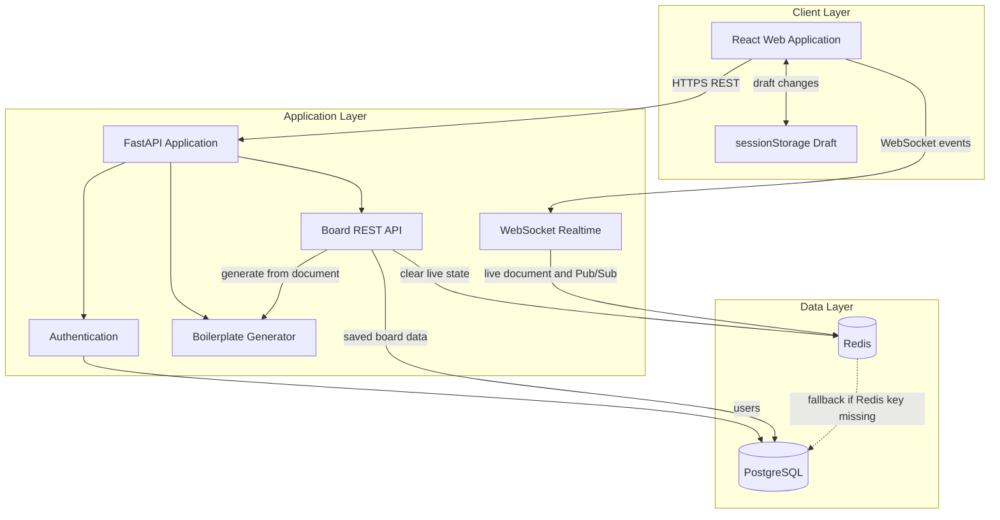
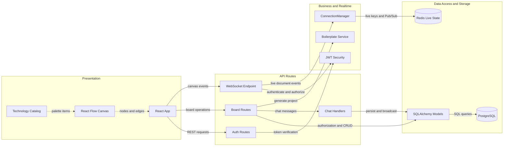

# Architecture Diagram

ArchBoard is a React and FastAPI architecture-design application with Redis-backed live collaboration and PostgreSQL-backed permanent storage. Unsaved edits move through the browser draft and Redis layers before they are committed to PostgreSQL by Save changes.

## Application Architecture

<!-- mermaid-checked: no \n, no em-dash/en-dash, no {} in labels, subgraphs are id["label"], arrows are -->|"label"|, all subgraphs closed by end, ids unique -->

### Technology Stack Summary

| Layer | Technology | Version | Purpose |
|---|---|---|---|
| Client | React | 18.3.1 | UI components and state |
| Diagram client | React Flow | 12.4.4 | Architecture canvas, nodes, and edges |
| Build tool | Vite | 6.0.5 | Frontend development and build |
| API | FastAPI | 0.115.8 | REST and WebSocket endpoints |
| Server runtime | Uvicorn | 0.34.0 | ASGI server |
| Data access | SQLAlchemy and asyncpg | 2.0.38 and 0.30.0 | Async PostgreSQL operations |
| Authentication | JWT and passlib/bcrypt | Project versioned dependencies | User authentication |
| Database | PostgreSQL | JSONB-capable | Durable users and board documents |
| Live state | Redis | Configured Redis instance | Live documents and Pub/Sub events |

### Data Storage & External Services

PostgreSQL stores users, board membership, saved board documents, and chat messages. Redis stores temporary live board documents for one hour and supports Pub/Sub broadcasts across FastAPI instances. If a Redis live document is missing, the backend falls back to the board document currently saved in PostgreSQL.

### Key Architectural Decisions

- Unsaved canvas edits are collaborative live state rather than direct database writes.
- The Redis live key expires after 3600 seconds and is deleted after a successful database save.
- Browser session drafts provide an additional temporary recovery path, but neither Redis nor sessionStorage is a permanent source of truth.

## Component Relationships

<!-- mermaid-checked: no \n, no em-dash/en-dash, no {} in labels, subgraphs are id["label"], arrows are -->|"label"|, all subgraphs closed by end, ids unique -->

### Component Inventory

| Component | Layer | Type | Responsibility |
|---|---|---|---|
| React App | Presentation | Application component | Authentication state, board selection, REST calls, and WebSocket handling |
| React Flow Canvas | Presentation | Diagram component | Render and edit architecture nodes and edges |
| Technology Catalog | Presentation | Data module | Defines available frontend, backend, database, and supporting technologies |
| Auth Routes | API | REST routes | Register, login, and current-user lookup |
| Board Routes | API | REST and WebSocket routes | Board CRUD, membership, chat, and boilerplate endpoints |
| Chat Handlers | API | Feature routes | Persist chat history and broadcast new messages |
| JWT Security | Business logic | Cross-cutting service | Create and verify access tokens |
| ConnectionManager | Realtime | Service | Redis live documents, rooms, presence, and cross-instance Pub/Sub |
| Boilerplate Service | Business logic | Code generator | Build generated project files and downloadable ZIP archive |
| SQLAlchemy Models | Data access | ORM models | Map users, memberships, boards, and chat rows |
| PostgreSQL | Data storage | Database | Permanent application and board data |
| Redis | Data storage | Live cache and Pub/Sub | Temporary live documents and collaboration broadcasts |
